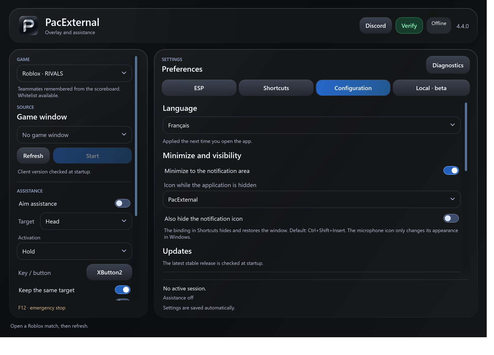

# PacExternal

**Customizable visuals and assistance for Roblox.**

Windows x64 &nbsp; · &nbsp; English and French

[Features](#features) &nbsp; · &nbsp; [Games](#games) &nbsp; · &nbsp; [Installation](#getting-started) &nbsp; · &nbsp; [Help](#quick-help) &nbsp; · &nbsp; [Français](README.md)

 

Your visuals, controls and preferences in one interface. Settings shown are examples.

## Features

<table>
<tr>
<td width="50%" valign="top"><strong>Customizable visuals</strong>
Choose which boxes, names and tracers to display, along with their colors.
</td>
<td width="50%" valign="top"><strong>Adjustable assistance</strong>
Set the target, radius, speed and activation mode from the interface.
</td>
</tr>
<tr>
<td width="50%" valign="top"><strong>Your own shortcuts</strong>
Assign keys to the main controls and switch options while using the application.
</td>
<td width="50%" valign="top"><strong>Saved configurations</strong>
Keep your preferences between sessions. Import or export configurations when needed.
</td>
</tr>
<tr>
<td width="50%" valign="top"><strong>Notification area</strong>
Minimize the window and restore it from its icon or with your shortcut.
</td>
<td width="50%" valign="top"><strong>Twelve Roblox profiles and Universal beta</strong>
Choose the options suited to your game or try the generic mode in another Roblox game.
</td>
</tr>
<tr>
<td width="50%" valign="top"><strong>Permanent whitelist</strong>
Save recognized accounts to always exclude them from visuals and assistance.
</td>
<td width="50%" valign="top"><strong>Beta prediction</strong>
Enable movement prediction and adjust its strength to suit your preferences.
</td>
</tr>
</table>

View shortcuts and preferences

 

<table>
<tr><th>Shortcuts</th><th>Preferences</th></tr>
<tr>
<td width="50%"></td>
<td width="50%"></td>
</tr>
</table>

## Games

RIVALS, Arsenal, BLITZ FPS, Revolver Arena, Hypershot, One Tap, Pixel Arena, KILLSTREAK, Phantom Forces, One Shot, BloxStrike and BRM5.

Teams follow the selected profile and game mode. One Tap, Pixel Arena and One Shot are free for all. In RIVALS, teammates identified from the scoreboard are remembered until you change servers.

| Profile | Compatibility |
| :--- | :--- |
| **BloxStrike** | Bomb Defusal: players, bots and automatic teams. Boxes and tracking are limited to visible opponents. |
| **BRM5** | PvP Sandbox: automatic teams with the game's teammate markers enabled. Other modes are not supported. |
| **Universal · beta** | Standard Roblox players and teams. Compatibility varies by game; bots and custom systems are not guaranteed. Prefer the dedicated profile when available. |

Account names and account-based whitelisting are unavailable in Phantom Forces and BRM5.

## Getting started

1. **[Download the Windows installer](https://github.com/Natt0001/PacExternal/releases/download/setup-1.0.0/PacExternal-Setup.exe).**
2. Run the file, then open PacExternal using the shortcut created on your desktop.
3. Select your game and its window, then click **Start**.

Adjust the visuals, assistance and shortcuts to suit your preferences.

## Controls

Customize your keys in the **Shortcuts** tab. **F12** remains the immediate stop command for assistance.

Default shortcuts

| Control | Shortcut |
| :--- | :--- |
| Show or hide the ESP | **F6** |
| Toggle player boxes | **F7** |
| Toggle tracers | **F8** |
| Toggle head boxes | **F9** |
| Scan RIVALS teammates from the scoreboard | **F10** |
| Hide or restore the application | **Ctrl + Shift + Insert** |
| Stop assistance immediately | **F12** |

## Quick help

When should I use Universal beta?

Try **Universal · beta** if your Roblox game has no dedicated profile. It recognizes standard characters and teams; support depends on the game. When a team cannot be recognized, assistance waits while **Ignore teammates** is enabled. In free for all, you can turn this filter off after checking.

How do I remember my teammates in RIVALS?

Enable **Ignore teammates**, hold **Tab**, then press **F10**. Once the scan is confirmed, teammates stay remembered after respawns and players joining or leaving. Changing servers resets this group; your whitelist stays saved.

How do I update PacExternal?

Quit the application completely, then open it again. Updates are checked at startup and your preferences are preserved. If the window is minimized, choose **Quit** from its notification icon.

How do I restore a hidden window?

Press **Ctrl + Shift + Insert**, or click the PacExternal icon in the notification area. You can change the key binding in **Shortcuts**.

How do I change the language?

Open **Configuration → Language**, select English or French, then restart PacExternal.

 

**[Download PacExternal](https://github.com/Natt0001/PacExternal/releases/download/setup-1.0.0/PacExternal-Setup.exe)** &nbsp; · &nbsp; [Release notes](https://github.com/Natt0001/PacExternal/releases) &nbsp; · &nbsp; [Discord](https://discord.gg/3fU73mZpqg)

