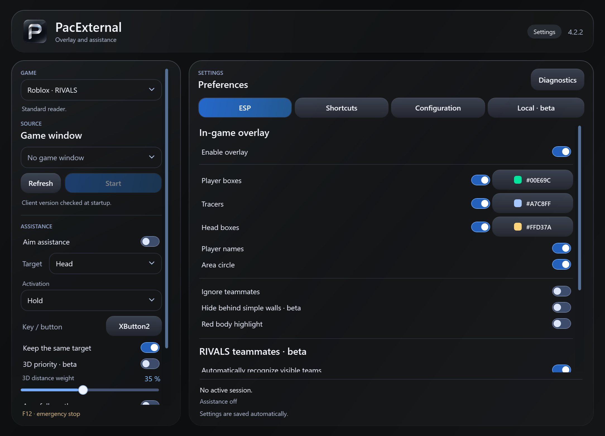
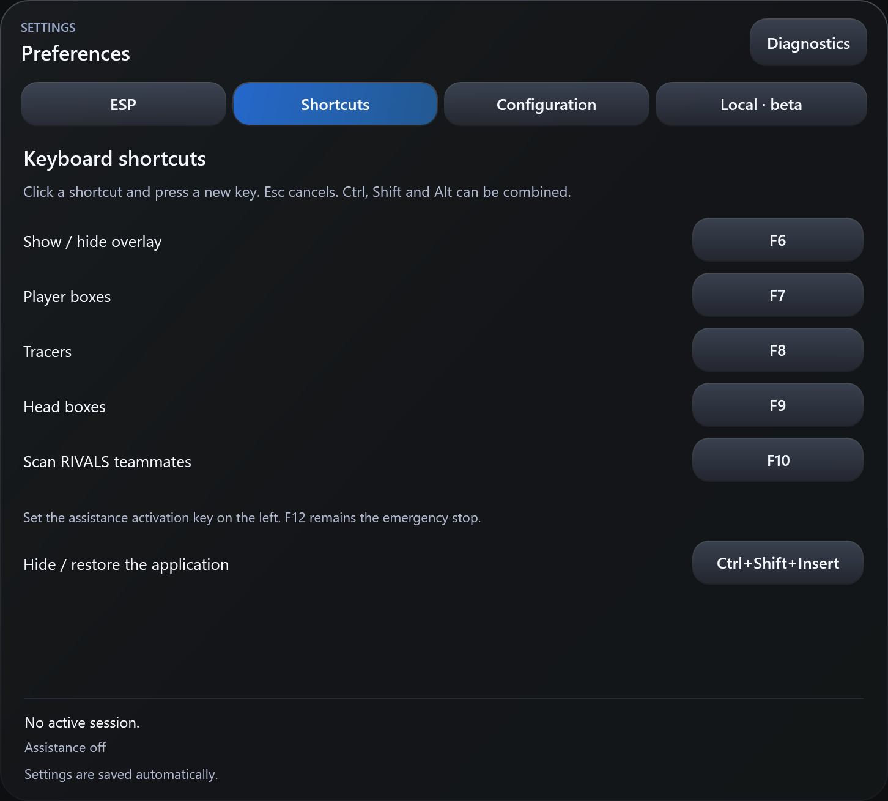

# PacExternal

**Customizable visuals and assistance for Roblox.**

Windows x64 &nbsp; · &nbsp; English and French

[Features](#features) &nbsp; · &nbsp; [Installation](#getting-started) &nbsp; · &nbsp; [Help](#quick-help) &nbsp; · &nbsp; [Français](README.md)

 

Your visuals, controls and preferences in one interface. Settings shown are examples.

## Features

<table>
<tr>
<td width="50%" valign="top"><strong>Customizable visuals</strong>
Choose which boxes, names and tracers to display, along with their colors.
</td>
<td width="50%" valign="top"><strong>Adjustable assistance</strong>
Set the target, radius, speed and activation mode from the interface.
</td>
</tr>
<tr>
<td width="50%" valign="top"><strong>Your own shortcuts</strong>
Assign keys to the main controls and switch options while using the application.
</td>
<td width="50%" valign="top"><strong>Saved configurations</strong>
Keep your preferences between sessions. Import or export configurations when needed.
</td>
</tr>
<tr>
<td width="50%" valign="top"><strong>Notification area</strong>
Minimize the window and restore it from its icon or with your shortcut.
</td>
<td width="50%" valign="top"><strong>Game profiles</strong>
Select your Roblox profile: RIVALS or Arsenal.
</td>
</tr>
</table>

View shortcuts and preferences

 

<table>
<tr><th>Shortcuts</th><th>Preferences</th></tr>
<tr>
<td width="50%"></td>
<td width="50%"></td>
</tr>
</table>

## Getting started

1. **[Download the Windows installer](https://github.com/Natt0001/PacExternal/releases/download/setup-1.0.0/PacExternal-Setup.exe).**
2. Run the file, then open PacExternal using the shortcut created on your desktop.
3. Select your game and its window, then click **Start**.

Adjust the visuals, assistance and shortcuts to suit your preferences.

## Controls

Customize your keys in the **Shortcuts** tab. **F12** remains the immediate stop command for assistance.

Default shortcuts

| Control | Shortcut |
| :--- | :--- |
| Show or hide the ESP | **F6** |
| Toggle player boxes | **F7** |
| Toggle tracers | **F8** |
| Toggle head boxes | **F9** |
| Scan teammates from the scoreboard | **F10** |
| Hide or restore the application | **Ctrl + Shift + Insert** |
| Stop assistance immediately | **F12** |

## Quick help

How do I update PacExternal?

Quit the application completely, then open it again. Updates are checked at startup and your preferences are preserved. If the window is minimized, choose **Quit** from its notification icon.

How do I restore a hidden window?

Press **Ctrl + Shift + Insert**, or click the PacExternal icon in the notification area. You can change the key binding in **Shortcuts**.

How do I change the language?

Open **Configuration → Language**, select English or French, then restart PacExternal.

 

**[Download PacExternal](https://github.com/Natt0001/PacExternal/releases/download/setup-1.0.0/PacExternal-Setup.exe)** &nbsp; · &nbsp; [Release notes](https://github.com/Natt0001/PacExternal/releases)

