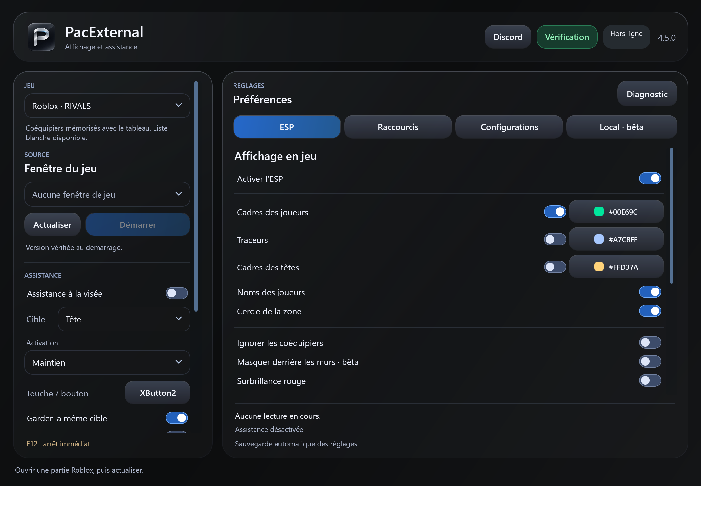
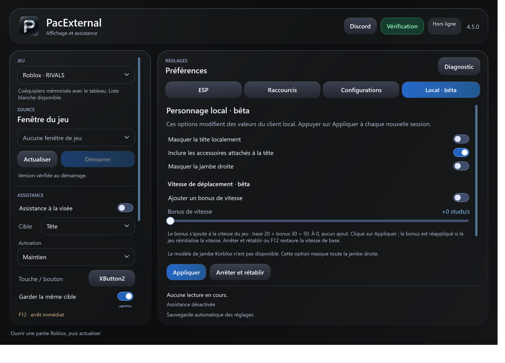
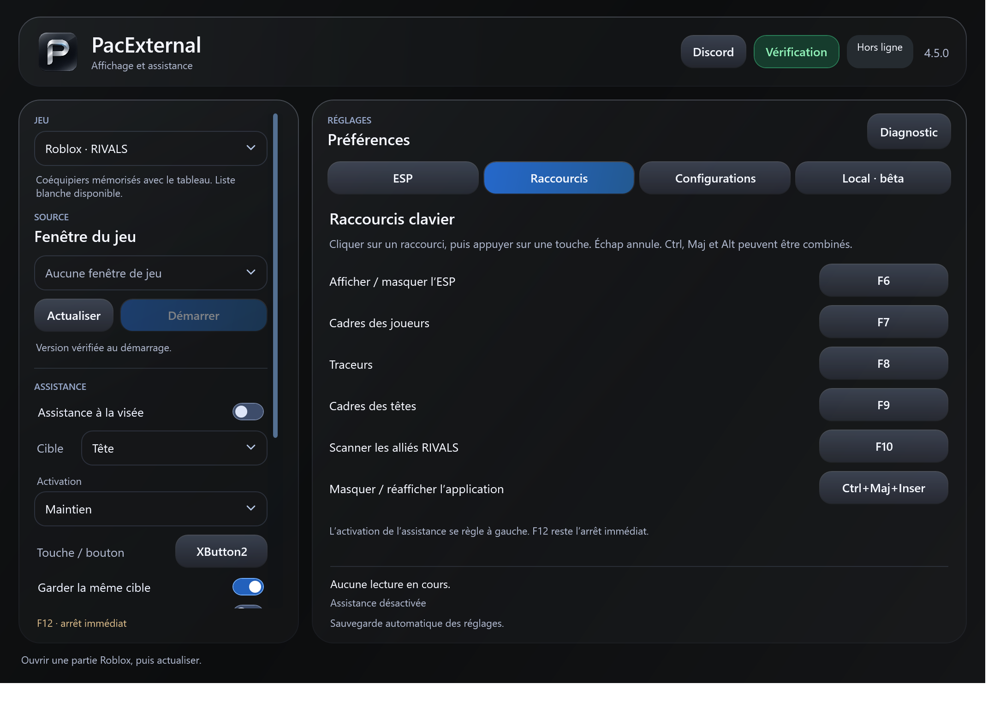
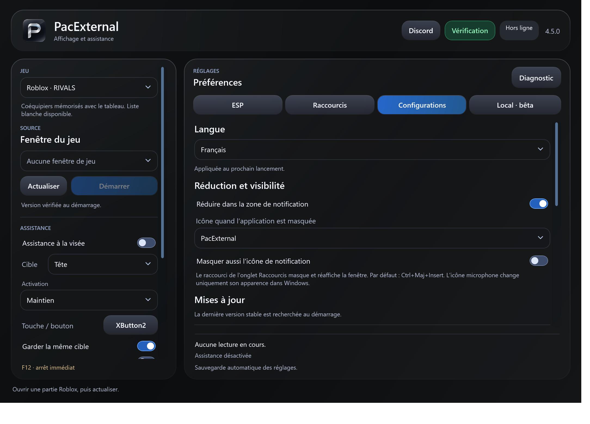

# PacExternal

**Affichage et assistance personnalisables pour Roblox.**

Windows x64 &nbsp; · &nbsp; Français et anglais

[Fonctionnalités](#fonctionnalités) &nbsp; · &nbsp; [Jeux](#jeux) &nbsp; · &nbsp; [Installation](#bien-démarrer) &nbsp; · &nbsp; [Aide](#aide-rapide) &nbsp; · &nbsp; [English](README.en.md)

 

Votre affichage, vos commandes et vos préférences dans une seule interface. Réglages présentés à titre d’exemple.

## Fonctionnalités

<table>
<tr>
<td width="50%" valign="top"><strong>Affichage personnalisable</strong>
Choisissez les cadres, les noms et les traceurs affichés, ainsi que leurs couleurs.
</td>
<td width="50%" valign="top"><strong>Assistance réglable</strong>
Ajustez la cible, le rayon, la vitesse et le mode d’activation depuis l’interface.
</td>
</tr>
<tr>
<td width="50%" valign="top"><strong>Raccourcis à la carte</strong>
Attribuez vos touches aux commandes principales et basculez entre vos options pendant l’utilisation.
</td>
<td width="50%" valign="top"><strong>Configurations sauvegardées</strong>
Retrouvez vos préférences au prochain lancement. Importez ou exportez vos configurations selon vos besoins.
</td>
</tr>
<tr>
<td width="50%" valign="top"><strong>Zone de notification</strong>
Réduisez la fenêtre et retrouvez-la depuis son icône ou avec votre raccourci.
</td>
<td width="50%" valign="top"><strong>Douze profils Roblox et Universal bêta</strong>
Retrouvez les options adaptées à votre jeu ou essayez le mode générique sur un autre jeu Roblox.
</td>
</tr>
<tr>
<td width="50%" valign="top"><strong>Liste blanche permanente</strong>
Enregistrez les comptes reconnus que vous souhaitez toujours exclure de l’affichage et de l’assistance.
</td>
<td width="50%" valign="top"><strong>Prédictions bêta</strong>
Activez l’anticipation des déplacements et ajustez sa force selon vos préférences.
</td>
</tr>
</table>

Vitesse de déplacement · bêta

Ajoutez un bonus de **0 à 200 studs/s** à la vitesse du jeu dans **Local · bêta**, puis cliquez sur **Appliquer**. Exemple : une base de 20 et un bonus de 30 donnent une vitesse de 50. À 0, aucun bonus n’est ajouté.

Le bonus est réappliqué si le jeu réinitialise la vitesse. **Arrêter et rétablir** ou **F12** restaure la vitesse de base. La compatibilité dépend du jeu et du personnage utilisé.

Voir les raccourcis et les préférences

 

<table>
<tr><th>Raccourcis</th><th>Préférences</th></tr>
<tr>
<td width="50%"></td>
<td width="50%"></td>
</tr>
</table>

## Jeux

RIVALS, Arsenal, BLITZ FPS, Revolver Arena, Hypershot, One Tap, Pixel Arena, KILLSTREAK, Phantom Forces, One Shot, BloxStrike et BRM5.

Les équipes suivent le profil et le mode de jeu. One Tap, Pixel Arena et One Shot sont en chacun pour soi. Dans RIVALS, les coéquipiers reconnus depuis le tableau restent mémorisés jusqu’au changement de serveur.

| Profil | À savoir |
| :--- | :--- |
| **BloxStrike** | Bomb Defusal : joueurs et bots, équipes automatiques. Cadres et suivi sur les adversaires visibles uniquement. |
| **BRM5** | PvP Sandbox : équipes automatiques avec les marqueurs d’alliés du jeu actifs. Les autres modes ne sont pas pris en charge. |
| **Universal · bêta** | Joueurs et équipes Roblox standard. La compatibilité varie selon le jeu ; bots et systèmes personnalisés non garantis. Préférez le profil dédié lorsqu’il existe. |

Sur Phantom Forces et BRM5, les noms de comptes et la liste blanche par compte ne sont pas disponibles.

## Bien démarrer

1. **[Téléchargez l’installateur Windows](https://github.com/Natt0001/PacExternal/releases/download/setup-1.0.0/PacExternal-Setup.exe).**
2. Lancez le fichier, puis ouvrez PacExternal depuis le raccourci créé sur votre Bureau.
3. Choisissez votre jeu et sa fenêtre, puis cliquez sur **Démarrer**.

Personnalisez ensuite l’affichage, l’assistance et les raccourcis selon vos préférences.

## Commandes

Les touches se personnalisent dans l’onglet **Raccourcis**. **F12** arrête immédiatement l’assistance et les effets locaux.

Raccourcis par défaut

| Commande | Raccourci |
| :--- | :--- |
| Afficher ou masquer l’ESP | **F6** |
| Activer ou désactiver les cadres | **F7** |
| Activer ou désactiver les traceurs | **F8** |
| Activer ou désactiver les cadres des têtes | **F9** |
| Scanner les coéquipiers RIVALS depuis le tableau | **F10** |
| Masquer ou réafficher l’application | **Ctrl + Maj + Inser** |
| Arrêter immédiatement l’assistance | **F12** |

## Aide rapide

Quand utiliser Universal bêta ?

Essayez **Universal · bêta** si votre jeu Roblox n'a pas de profil dédié. Ce mode reconnaît les personnages et équipes standard ; la compatibilité dépend du jeu. Si l'équipe n'est pas reconnue, l'assistance attend lorsque **Ignorer les coéquipiers** est actif. En chacun pour soi, vous pouvez désactiver ce filtre après vérification.

Comment mémoriser mes coéquipiers dans RIVALS ?

Activez **Ignorer les coéquipiers**, maintenez **Tab**, puis appuyez sur **F10**. Une fois le scan confirmé, les alliés restent mémorisés après les respawns et les arrivées ou départs de joueurs. Un changement de serveur réinitialise ce groupe ; la liste blanche reste enregistrée.

Comment mettre PacExternal à jour ?

Quittez complètement l’application, puis relancez-la. La mise à jour est recherchée au démarrage et vos réglages sont conservés. Si la fenêtre est réduite, utilisez **Quitter** depuis l’icône de notification.

Comment retrouver une fenêtre masquée ?

Utilisez **Ctrl + Maj + Inser**, ou cliquez sur l’icône PacExternal dans la zone de notification. Le raccourci peut être modifié dans **Raccourcis**.

Comment changer la langue ?

Ouvrez **Configurations → Langue**, choisissez français ou anglais, puis relancez PacExternal.

 

**[Télécharger PacExternal](https://github.com/Natt0001/PacExternal/releases/download/setup-1.0.0/PacExternal-Setup.exe)** &nbsp; · &nbsp; [Notes de version](https://github.com/Natt0001/PacExternal/releases) &nbsp; · &nbsp; [Discord](https://discord.gg/3fU73mZpqg)

